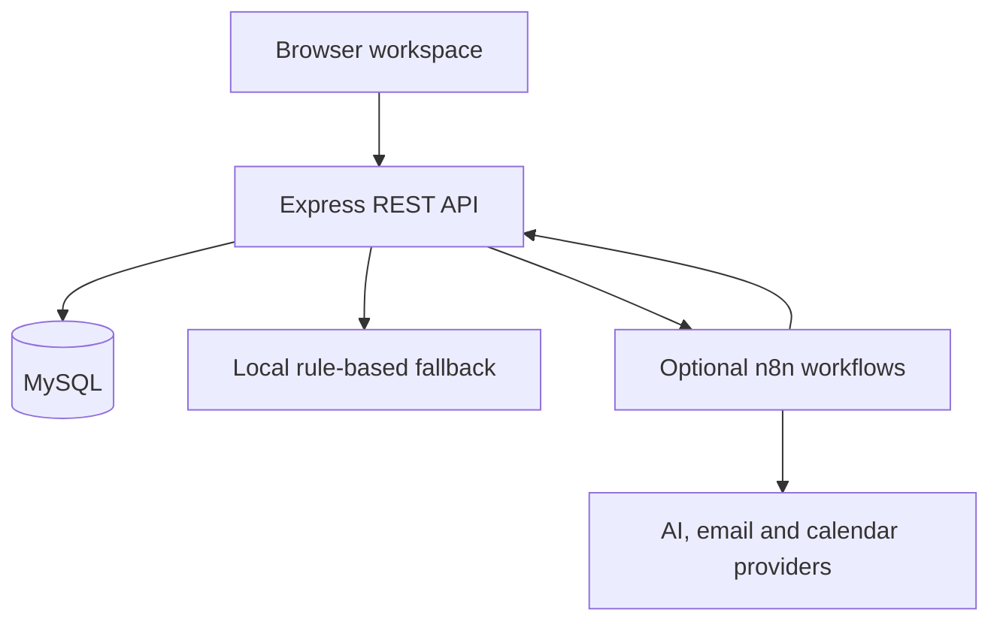

<div align="center">

# Plotwise
### Real estate operations, in one workspace.

**Property listings · Lead management · Viewings · Leases · Maintenance · Automation**

[Technical guide](plotwise/plotwise/README.md) · [Workflow definitions](plotwise/plotwise/n8n/workflows) · [Upwork project summary](UPWORK.md)


</div>

## The problem

A property agency needs more than a listing page. Enquiries need follow-up, agents need a shared pipeline, viewings need coordination, and landlords need visibility into rent and maintenance. Moving between disconnected spreadsheets makes that work difficult to track.

Plotwise is a full-stack portfolio application that brings these workflows together. It demonstrates an Express API, a MySQL data model, a responsive browser interface, and integration points for n8n.

## What is included

| Workspace | Capabilities in the codebase |
|---|---|
| Property listings | Search and filters, map display, property details and enquiry capture |
| Sales CRM | Lead pipeline, agent assignment, activity history and reply records |
| Viewings | Booking, availability and viewing status |
| Deal finder | Import market records, compare listings and save searches |
| Property management | Leases, rent schedules, maintenance tickets and owner statements |
| Analytics | Pipeline summaries and automation activity |
| Automation | Twelve importable n8n workflow definitions and local fallbacks for selected actions |
| Accounts | JWT authentication and role checks for admin, agent, buyer, landlord and tenant |

These are portfolio capabilities, not a claim of production readiness or a completed security audit. Market data and demo records are illustrative.

## A clear distinction: prepared versus delivered

**Local demo mode** requires no AI key or n8n account. It uses deterministic rules for selected workflows. Lead replies are saved as **queued templates**, and no email is sent. Generating a template does not mark a lead contacted or start its follow-up timer.

**Connected mode** requires a separately configured n8n instance and provider credentials. AI scoring, email delivery, calendar events and scheduled actions must be verified against those providers. Having workflow JSON in the repository does not establish that an integration is active.

Previously stored demo replies may retain delivery labels created by older versions. The correction applies to new processing; historical rows are not rewritten.

## Architecture



**Stack:** Node.js, Express, MySQL, JavaScript, HTML/CSS, JWT, Leaflet and n8n. The optional workflow definitions include Gemini integration. No frontend build step is required.

## Run locally

Use Node.js 22 and Docker Compose for the local MySQL service.

```bash
git clone https://github.com/asadh-74/Plotwise.git
cd Plotwise/plotwise/plotwise
npm ci
cp .env.example .env
docker compose up -d mysql
```

On Windows Command Prompt, use `copy .env.example .env`. Edit `.env` and replace both secret placeholders with separate random values. You can generate a value locally with:

```bash
node -e "console.log(require('node:crypto').randomBytes(32).toString('hex'))"
```

Keep `N8N_WEBHOOK_BASE` empty for local demo mode. The supplied local database configuration matches Docker Compose. Wait for MySQL to finish initializing, then run:

```bash
npm run dev
```

Open **http://localhost:3000**. With fictional demo seeding enabled, use `agent@plotwise.demo` and password `demo1234`. Other seeded roles use `admin`, `buyer`, `landlord` or `tenant` before `@plotwise.demo`. These are public demo credentials, never accounts for private data.

## Configuration

| Variable | Purpose |
|---|---|
| `DATABASE_URL` | Dedicated MySQL connection string; required for hosted operation |
| `JWT_SECRET` | Private, randomly generated signing secret |
| `AUTOMATION_SECRET` | Separate private secret for n8n callbacks |
| `DB_CA_PEM` / `DB_CA_PATH` | Database CA certificate for verified TLS |
| `DEMO_SEED` | Set `true` only for fictional demo data |
| `APP_BASE_URL` | Public application address used in workflows |
| `N8N_WEBHOOK_BASE` | Optional production n8n webhook base |
| `APP_TZ_OFFSET` | Database timezone offset; local example is `+05:00` |
| `PORT` | Listening port; provided by Render |

Store private values in the hosting environment. Never commit `.env`, database passwords, API keys or customer records. Use a dedicated database/schema for Plotwise to avoid collisions with other applications.

## Render deployment

Create a **Node web service** from this repository with:

| Setting | Value |
|---|---|
| Branch | `main` |
| Root directory | `plotwise/plotwise` |
| Build command | `npm ci` |
| Start command | `npm start` |
| Health check | `/health` |
| Compute | Free, subject to Render availability and limits |

If the service root is left empty, use `npm --prefix plotwise/plotwise ci` and `npm --prefix plotwise/plotwise start` instead. Configure MySQL and secrets before attempting to use the app. A web-service deployment does not create a MySQL database or activate n8n.

The app initializes its schema before listening. Incorrect database configuration prevents startup. Free hosting may sleep after inactivity; allow time for a cold start. See the [technical guide](plotwise/plotwise/README.md) for database and workflow setup.

## Verify the project

From `plotwise/plotwise`:

```bash
npm test
node --check public/app.js
```

Four regression tests cover local queued templates, missing delivery status, explicit delivery confirmation and failed delivery. They use a stub database. GitHub Actions installs the locked dependencies and runs the tests and frontend syntax check. These checks do **not** replace a MySQL integration test or verification of live email/calendar delivery.

## Suggested portfolio walkthrough

1. Open a listing and inspect its details.
2. Sign in as the demo agent and simulate a new enquiry.
3. Inspect the rule-based score, activity history and **queued template**.
4. Move the lead through the pipeline and demonstrate a viewing.
5. Explore lease, rent and maintenance workspaces.
6. Show automation logs and explain local versus connected mode.

Use fresh fictional data and only demonstrate integrations that have been tested. Sample deal comparisons are not validated property valuations. Public demo accounts must never contain private customer or financial information.

## Repository map

| Path | Contents |
|---|---|
| `plotwise/plotwise/public/` | Browser interface |
| `plotwise/plotwise/src/routes/` | REST endpoints |
| `plotwise/plotwise/src/services/` | Business workflow logic |
| `plotwise/plotwise/src/automation/` | n8n triggers and run tracking |
| `plotwise/plotwise/db/schema.sql` | Application schema |
| `plotwise/plotwise/n8n/workflows/` | Twelve example workflow definitions |
| `plotwise/plotwise/test/` | Regression tests |
| `.github/workflows/test.yml` | Automated repository checks |

Built by **Asad Hussain** · [GitHub](https://github.com/asadh-74)
